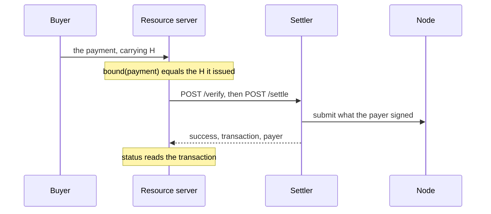

# The settler

In x402, a **facilitator** is the role that verifies and settles. A resource server sends it the buyer's payment and
the requirements that payment answers. `POST /verify` says whether the payment is valid, `POST /settle` submits it to
its network and answers with the transaction, and `GET /supported` lists the kinds of payment it serves. The seller
chooses its facilitator. This page is for a seller choosing one, and for the operator of the settler: at the end you
know where the facilitator sits beside the resource server, and what the settler declares and records.

## Where it sits

The resource server and the facilitator do different jobs, in this order:

1. **The resource server checks H.** `bound(payment)` reads H from what the buyer presented, and the resource server
   accepts the payment only where that H is the one it issued for this request and has not accepted before
   ([Seller: check the payment](../guides/seller.md#4-check-the-payment)). Those two facts are its own records, and
   its refusals come here, before money moves.
2. **The facilitator verifies and settles.** `/verify` says the payment is valid for its requirements; `/settle`
   submits it and names the transaction.
3. **The resource server reads the settlement.** The facilitator's `transaction` is the payment's reference on chain,
   and `status` reads it through a reader the resource server supplies
   ([Seller: read the settlement](../guides/seller.md#5-read-the-settlement)).

## The settler

`@integraledger/profile-facilitator`, in this repository's
[`settler/`](https://github.com/IntegraLedger/integra-protocol/tree/main/settler) folder, is a facilitator for the x402
pairings `@integraledger/lcp` implements, which holds each payment to its pairing's LCP profile (hence its name), on one
HTTP surface: `GET /supported`, `POST /verify` and `POST /settle`. It runs x402's own facilitator class,
`x402Facilitator` of `@x402/core` 2.31.0, with one registration for each scheme on each network it is configured with.
Behind each registration is a **module**: x402's published facilitator class for that chain, registered unchanged, or
the settler's own facilitator where x402 publishes no class. Around the class it adds three things:

- **lcp's checks of the pairing**, made from the payment and its requirements alone before the class is asked: the
  payment carries H in its profile's form, and its form is one the kind declares.
- **The record**: one row per payment in Postgres, so that one payment is submitted once and answered success once.
- **lcp's read of the chain**, which decides whether a payment the class did not answer success for is final.

It checks the amount, asset and payee against the requirements because x402 requires that of a facilitator, and
carries no business or legal logic beyond that. It does not know which H the resource server issued.

## What it declares

There is no list of the settler's kinds: a resource server reads them from `/supported`. Each kind's `extra` carries,
with the class's own members:

- `extra.pairings`: the pairing ids the kind submits, since a scheme on one network can hold several forms.
- `extra.key`: what the module's key signs. `none`: the module holds no key and submits what the payer signed, and the
  payer pays the fee. `relayer`: the key sends the transaction and pays its network fee. `fee-payer`: the key co-signs
  the payer's transaction as the account that pays its fee. The key is always the seller's, given to the module as the
  signer object its class takes.
- `extra.acceptsZero`: whether the kind settles a payment of amount zero, which a seller choosing a zero agreement
  amount needs to know.
- `extra.feeBudget`: present, and `true`, where the operator capped the fees its keys pay on the network, so that the
  settler may refuse every payment there for a period.

A deployment with a keyed module does not start without a credential, and every call must then present it: the
resource server names the payee and the amount, and an open settler would pay fees for payments between other parties.

## The record

The settler keys each payment by its **instrument**, the single-use value its signer signed as the pairing's profile
names it: an authorization nonce, a sequence number, an account nonce, or a transaction id that the signed content alone
fixes; where the pairing's single-use value is not shown (a batch settlement, an `upto` claim), the digest of the signed
payment. It is never the single-use value alone, which two payers can share, and never a hash that a copy signed again
would change, so an agreement and a payment of one payer under one H are two instruments.

A payment is claimed by one conditional insert, so of two settles of one payment only one submits, and a success is
answered once, to the settle whose write stored it. A row is final once its answer can never change: a success, a failed
result that consumed the single-use value, a value another act consumed, a validity that passed with the value unused,
or a payment that landed by another route. A repeated `/settle` of a final row answers `invalid_transaction_state`
naming the transaction, never a second success, as x402's `exact` family requires. Where the chain has not yet shown a
final answer, `/settle` answers `settlement_pending` naming the transaction, and a repeat reads the chain again.

[Run the settler](../guides/settler.md) starts it and configures each module, and the
[settler reference](../reference/settler.md) gives its HTTP API, its reasons and its storage.
