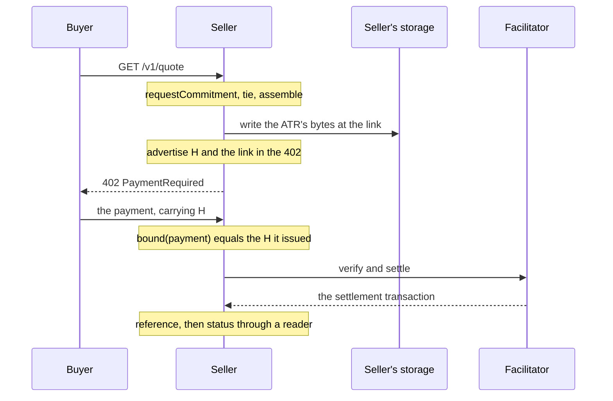

# Seller

The **seller** is the party serving the resource. Its side of the binding has four steps: assemble the ATR for this
request, advertise H in the challenge, read H back from the payment it receives, and read the settlement from the
rail. This guide walks them on x402 with `x402/exact/eip155/eip3009`. Every pairing has the same
[members](../concepts/pairings.md#the-members), except that `mpp/charge/nearintents` has no `build`, so the shape is the
same on every surface.



The **facilitator** is the x402 role that verifies and settles. It is the seller's to choose; this package does not
call it.

## 1. Assemble the ATR for this request

The ATR's binding slot ties the record to one payment. On x402, `tie(accepts, request)` records every option the
challenge offers, exactly as issued, and the commitment to the request it answers: the method, the path, the query
and SHA-256 over the body exactly as received. The party slots carry whatever the parties agreed, as bytes.

## 2. Store the bytes and link them

Write the ATR's bytes to your own storage before the challenge goes out, and serve them unchanged at an `https` link.
If the write fails, send no challenge: a buyer that cannot fetch the record declines.

### Serving the link

The buyer gates decline the link unless it answers `200` with no redirect, in the identity coding (no
`Content-Encoding`, or `identity`), with at most 1 MiB, within 10 seconds
([`vectors/buyer.json`](../../lcp/vectors/buyer.json) rows `B11` to `B14` and `BE1`). Make the link unguessable: H is
in the challenge, and on most pairings in the payment, so build the link from a random token, not from H. Let it
expire after a short period, minutes (`LCP §12.4`), once the buyer has had time to fetch the bytes (`LCP §6.1`). The
binding slot records the request's path and query, and the link serves those bytes to whoever fetches it, so keep
secrets out of the query.

## 3. Advertise H

`advertise(doc, h, link, offer)` returns a copy of the challenge with `extensions.legalContext.info` set to
`{"type":"sha256","value":H,"legalContextUrl":link}`, beside its `schema`, and leaves every other extension and every
option as they were.
On pairings that carry H in the option itself, such as `x402/exact/solana` (`extra.memo`), it also places H there.
A challenge, or an option in its `accepts`, that carries a `refused` member is refused as `x402/option-malformed`
before anything is placed ([Refusals](../concepts/refusals.md#where-a-refusal-comes-from)).

## 4. Check the payment

`bound(payment)` reads H from what the buyer presented: here, the EIP-3009 authorization's `nonce`. Match it with
`hashEquals` against the H you issued for this request. The token contract verifies the signature when it executes
the transfer; `bound` does not.

Refuse a payment whose H you did not issue for this request, and one whose H you have already accepted. Those two
facts are your records, not this package's.

## 5. Read the settlement

`reference(payment)` gives the keys for finding this payment on chain: the network, the token, the time bound, a
digest of the transfer, the log that carries H, and `authorization`, the signed authorization as the token records its
use. After the facilitator settles, `status` reads the settlement transaction through a reader you supply, and
`recover` reads H back from that transaction alone.

`status` settles a named transaction only when it is this payment's: its receipt must hold the token's
`AuthorizationUsed` log whose nonce is H and the `Transfer` that same authorization produced, the one from the
authorizer that log order pairs with it ([the x402 guide](./x402.md#a-named-transaction) gives the rule), whose payer,
payee and value hash to the reference's digest. A transaction whose receipt the reader does not hold, where `receipt`
answers `null`, is pending `not-found`, and a failed read is pending `unreadable`. Anything else is `failed`, with the
reason, once the receipt's block is at or below the reader's `finalized` mark; above that mark, where the block can be
replaced, or where the mark cannot be read, it is pending with the same reason. A `settled` answer at `latest` (EVM) or
`head` (Polkadot, Tron) can be reorganised away; read it again until it is final: `finalized`, or `solidified` on Tron.

Before any transaction is named, `authorizer(payment)` gives the account whose signature authorises the transfer, and
`authorizationUsed(ref, authorizer, block, reader)` asks the token whether that authorization had executed by a block.
The authorization cannot execute in a block whose timestamp is at or after its `deadline`, so once a final block is
past it, an unused authorization never moves money.

## The whole flow

This program runs every step above. A `Map` stands in for the seller's storage, a random key for the buyer's signer,
and a reader built from one receipt for the chain. No network is used.

```ts
import { assemble, hashEquals, isRefusal, newAtrId } from "@integraledger/lcp";
import {
  AUTHORIZATION_USED_TOPIC,
  TRANSFER_TOPIC,
  authorizationUsed,
  type EvmReader,
  type Hex,
} from "@integraledger/lcp/evm";
import {
  exactEip3009,
  requestCommitment,
  tie,
  type PaymentRequired,
  type PaymentRequirements,
} from "@integraledger/lcp/x402";
import type { TypedDataDefinition } from "viem";
import { generatePrivateKey, privateKeyToAccount } from "viem/accounts";

const option: PaymentRequirements = {
  scheme: "exact",
  network: "eip155:84532",
  amount: "10000",
  asset: "0x036CbD53842c5426634e7929541eC2318f3dCF7e",
  payTo: "0x209693Bc6afc0C5328bA36FaF03C514EF312287C",
  maxTimeoutSeconds: 60,
  extra: { name: "USDC", version: "2" },
};
const challenge: PaymentRequired = {
  x402Version: 2,
  resource: { url: "https://api.seller.example/v1/quote" },
  accepts: [option],
};

// 1. Assemble the ATR for this request.
const request = await requestCommitment({ method: "GET", target: "/v1/quote", body: new Uint8Array() });
if (isRefusal(request)) throw new Error(request.code);
const terms = new TextEncoder().encode('{"text":"One quote for 10000 base units of USDC."}');
const atr = await assemble(newAtrId(), tie(challenge.accepts, request), [["terms", terms]]);
if (isRefusal(atr)) throw new Error(atr.code);

// 2. Store the bytes and link them.
const link = `https://atr.seller.example/${crypto.randomUUID()}`;
const storage = new Map([[link, atr.bytes]]);

// 3. Advertise H.
const advertised = exactEip3009.advertise(challenge, atr.atrHash, link, option);
if (isRefusal(advertised)) throw new Error(advertised.code);
console.log("advertised:", JSON.stringify(advertised.extensions?.["legalContext"]?.info) === JSON.stringify({
  type: "sha256",
  value: atr.atrHash,
  legalContextUrl: link,
}));

// The buyer's side, in brief: see the buyer guide.
const payer = privateKeyToAccount(generatePrivateKey());
const unsigned = await exactEip3009.build({ required: advertised, accepted: option, from: payer.address, now: 1790000000 }, atr.atrHash);
if (isRefusal(unsigned)) throw new Error(unsigned.code);
const payment = unsigned.complete(await payer.signTypedData(unsigned.typedData as TypedDataDefinition));
if (isRefusal(payment)) throw new Error(payment.code);

// 4. Check the payment.
const h = await exactEip3009.bound(payment);
if (typeof h !== "string") throw new Error(h.code);
console.log("bound to the issued H:", hashEquals(h, atr.atrHash), storage.has(link));

// 5. Read the settlement. The facilitator's settle answer names the transaction.
const ref = await exactEip3009.reference(payment);
if (isRefusal(ref)) throw new Error(ref.code);
const transaction: Hex = `0x${"11".repeat(32)}`;
const word = (hex: string): Hex => `0x${hex.replace(/^0x/, "").toLowerCase().padStart(64, "0")}`;
const reader: EvmReader = {
  network: "eip155:84532",
  receipt: async () => ({
    status: 1,
    blockNumber: 100n,
    logs: [
      { address: option.asset as Hex, topics: [AUTHORIZATION_USED_TOPIC, word(payer.address), h], data: "0x" },
      {
        address: option.asset as Hex,
        topics: [TRANSFER_TOPIC, word(payer.address), word(option.payTo)],
        data: word(BigInt(option.amount).toString(16)),
      },
    ],
  }),
  blockNumber: async (tag) => (tag === "finalized" ? 100n : 105n),
  transaction: async () => null,
  // The token's authorizationState(authorizer, nonce): true once the authorization is used.
  call: async () => word("1"),
};
const status = await exactEip3009.status({ ...ref, transaction, h }, reader);
console.log("status:", status.state, "finality" in status ? status.finality : status.why);
const authorizer = await exactEip3009.authorizer(payment);
if (typeof authorizer !== "string") throw new Error(authorizer.code);
console.log("authorization used by block 100:", await authorizationUsed(ref, authorizer, 100n, reader));
const recovered = await exactEip3009.recover({ network: ref.network, asset: ref.asset, transaction }, reader);
console.log("recovered from the chain alone:", typeof recovered === "string" && hashEquals(recovered, atr.atrHash));
```

```text
advertised: true
bound to the issued H: true true
status: settled finalized
authorization used by block 100: true
recovered from the chain alone: true
```

## The agreement URL

Where the chosen pairing's `pattern.publicProof` is false, the payment is not a public proof of H, and the buyer gates
require an agreement URL: pass it to `advertise` as `agreementUrl`, and `read` returns it as `agreement`. The buyer
gates decline an offer that names none (`agreement-not-offered`). The buyer pays that URL first, with a payment that is
itself a public proof of H, and makes the full payment only after the URL's receipt. Build the agreement URL from a
random token too, not from H, as [Serving the link](#serving-the-link) says of the link: unpaid, it answers with a
challenge that advertises the link.

[`vectors/buyer.json`](../../lcp/vectors/buyer.json) fixes the exchange in `fixed.agreement` and the `BA` rows:

- **Unpaid**, the URL answers `402` with `PAYMENT-REQUIRED`: the base64 of an x402 challenge, pad characters included
  and pad bits zero (RFC 4648 §3.5), as a standard encoder writes it, advertising the same H and link. The buyer gates
  decline a challenge that advertises another H (`BA2`), a header without its pad characters (`BA13`) and a header with
  a pad bit set (`BA19`).
- **Settling**, a paid request answers `202` with `Retry-After`, and the buyer sends the same signed payment again,
  until the agreement option's `maxTimeoutSeconds` plus 180 seconds have passed (`BA1`, `BA3`). The buyer gates decline
  an unpaid request answered `202` as `agreement-pending`, and sign nothing (`BA14`).
- **Recorded**, a paid request answers `200` with the receipt
  `{"atrHash": H, "agreed": true, "network": …, "transaction": …}`. The buyer gates require all four members: `atrHash`
  naming the same H (`BA4`), `agreed` true, and `network` and `transaction` strings.

Answer in the identity coding: the buyer asks with `Accept-Encoding: identity` and declines any other
`Content-Encoding` (`BE2`). [The agreement URL](../concepts/buyer-gate.md#the-agreement-url) gives the buyer's side.

## What the seller keeps

Keep H, the link and the reference for each payment, and the ATR's bytes in your storage after the link expires; the
buyer keeps its own copy.

## What this package does not do

It holds no key and signs nothing. It does not call the facilitator, move funds, or decide whether to serve a
request. It never judges amount, payee, asset, timing or payer, and never reads the parties' content in the ATR.
Beside the binding, it checks only the form the rail or the scheme requires and the bounds within which it reads its
input.

## On other surfaces

The members are the same everywhere, except that `mpp/charge/nearintents` has no `build`; what `tie`, `advertise` and
`bound` handle differs:

- [x402](./x402.md): the `legalContext` extension, and every x402 pairing.
- [MPP](./mpp.md): H as the challenge id.
- [Agentic checkouts](./checkouts.md): ACP, UCP, AP2, ACK, card networks and A2A.
- [Channels, sessions and subscriptions](./sessions.md): one ATR for a whole channel.
