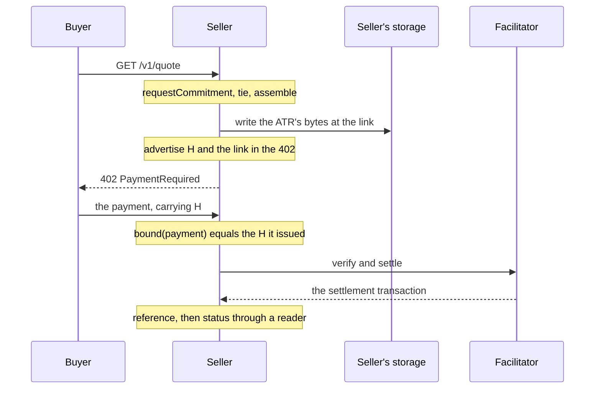

# Seller

The **seller** is the party serving the resource. Its side of the binding has four steps: assemble the ATR for this
request, advertise H in the challenge, read H back from the payment it receives, and read the settlement from the
rail. This guide walks them on x402 with `x402/exact/eip155/eip3009`. Every pairing has the same
[members](../concepts/pairings.md#the-members), so the shape is the same on every surface; eight have no `build`,
because the payer's own client builds their payment ([On other surfaces](#on-other-surfaces) names them). At the end
you have a program that runs the seller's whole side, and the exchanges an agreement-first sale adds.



The **facilitator** is the x402 role that verifies and settles. It is the seller's to choose; this package does not
call it. This repository's [settler](../concepts/settler.md) is one, for most of the x402 pairings this package
implements; [What it does not serve](./settler.md#what-it-does-not-serve) lists the others.

## 1. Assemble the ATR for this request

The ATR's binding slot ties the record to one payment. On x402, `tie(accepts, request)` records every option the
challenge offers, exactly as issued, and the commitment to the request it answers: the method, the path, the query
and SHA-256 over the body exactly as received. The party slots carry whatever the parties agreed, as bytes.

## 2. Store the bytes and link them

Write the ATR's bytes to your own storage before the challenge goes out, and serve them unchanged at an `https` link.
If the write fails, send no challenge: a buyer that cannot fetch the record declines.

### Serving the link

The buyer gates decline the link unless it answers `200` with no redirect, in the identity coding (no
`Content-Encoding`, or `identity`), with at most 1 MiB, within 10 seconds
([`vectors/buyer.json`](../../lcp/vectors/buyer.json) rows `B11` to `B14` and `BE1`). Make the link unguessable: H is
in the challenge, and on most pairings in the payment, so build the link from a random token, not from H. Let it
expire after a short period, minutes (`LCP §12.4`), once the buyer has had time to fetch the bytes (`LCP §6.1`). The
binding slot records the request's path and query, and the link serves those bytes to whoever fetches it, so keep
secrets out of the query.

## 3. Advertise H

`advertise(doc, h, link, offer)` returns a copy of the challenge with `extensions.legalContext.info` set to
`{"type":"sha256","value":H,"legalContextUrl":link}`, beside its `schema`, and leaves every other extension and every
option as they were.
On pairings that carry H in the option itself, such as `x402/exact/solana` (`extra.memo`), it also places H there.
A challenge, or an option in its `accepts`, that carries a `refused` member is refused as `x402/option-malformed`
before anything is placed ([Refusals](../concepts/refusals.md#where-a-refusal-comes-from)).
Send the result as `encodeHeader(advertised)` in the `PAYMENT-REQUIRED` header of the `402`
([The headers](./x402.md#the-headers)).

## 4. Check the payment

Read the payment from the retried request's `PAYMENT-SIGNATURE` header with `decodePaymentSignature(header)`.
`bound(payment)` reads H from what the buyer presented: here, the EIP-3009 authorization's `nonce`. Match it with
`hashEquals` against the H you issued for this request. The token contract verifies the signature when it executes
the transfer; `bound` does not.

Refuse a payment whose H you did not issue for this request, and one whose H you have already accepted. Those two
facts are your records, not this package's.

## 5. Read the settlement

`reference(payment, option)` gives the keys for finding this payment on chain, with the payee of `option`, the option
the payment answers: the network, the token (`asset`), the payer, `validBefore`, H (`h`) and `presented`, the
authorization's members as presented. After the facilitator settles, add the transaction its settle answer names as
`transaction`: `status` reads it beside its own search, and never needs it. `status(ref, reader, query)` then reads
the act `query.act` names, `"payment"` here, through a reader you supply, at the finality `query.finality` asks for.
Ask for `"finalized"`: a block above that mark can be replaced. `recover({ network, tx, option }, reader)` reads H back
from the transaction alone.

`status` answers `settled`, `pending`, `failed` or `unreadable`, each with one reason from a closed list
([the x402 guide](./x402.md#reading-the-payment) gives it). It settles on a transaction that carries H, was signed by
the payment's payer and pays the option's payee, read at the finality asked for or above it; below it, the answer is
pending `below-mark`. It never compares the amount: `presented` on a settled answer says whether the landed
authorization is the one presented. A reader call that rejects, or a reader that declares another network, makes the
answer `unreadable`, never `failed`. Each rail's marks are in [Reading settlement](./rails.md#reading-settlement).

Before any transaction is named, `status` reads whether the authorization has been used: at the final mark, and,
through a reader that has `block`, at the latest head. It answers pending `instrument-live` while the authorization is
unused at both and still valid. `authorizer(payment)` gives the account whose signature authorises the transfer, and
`authorizationUsed({ network, authorization }, authorizer, block, reader)` asks the token whether that authorization
had executed by a given block, with `authorization` built from the reference as the program below builds it. The
authorization cannot execute in a block whose timestamp is at or after its `validBefore`, so once a final block is past
that time, an unused authorization never moves money.

## The whole flow

This program runs every step above. A `Map` stands in for the seller's storage, a random key for the buyer's signer,
and a reader built from one receipt for the chain. No network is used.

```ts
import { assemble, hashEquals, isRefusal, newAtrId } from "@integraledger/lcp";
import {
  AUTHORIZATION_USED_TOPIC,
  TRANSFER_TOPIC,
  authorizationUsed,
  type EvmReader,
  type Hex,
} from "@integraledger/lcp/evm";
import {
  decodePaymentRequired,
  decodePaymentSignature,
  encodeHeader,
  exactEip3009,
  requestCommitment,
  tie,
  type PaymentRequired,
  type PaymentRequirements,
} from "@integraledger/lcp/x402";
import type { TypedDataDefinition } from "viem";
import { generatePrivateKey, privateKeyToAccount } from "viem/accounts";

const option: PaymentRequirements = {
  scheme: "exact",
  network: "eip155:84532",
  amount: "10000",
  asset: "0x036CbD53842c5426634e7929541eC2318f3dCF7e",
  payTo: "0x209693Bc6afc0C5328bA36FaF03C514EF312287C",
  maxTimeoutSeconds: 60,
  extra: { name: "USDC", version: "2" },
};
const challenge: PaymentRequired = {
  x402Version: 2,
  resource: { url: "https://api.seller.example/v1/quote" },
  accepts: [option],
};

// 1. Assemble the ATR for this request.
const request = await requestCommitment({ method: "GET", target: "/v1/quote", body: new Uint8Array() });
if (isRefusal(request)) throw new Error(request.code);
const terms = new TextEncoder().encode('{"text":"One quote for 10000 base units of USDC."}');
const atr = await assemble(newAtrId(), tie(challenge.accepts, request), [["terms", terms]]);
if (isRefusal(atr)) throw new Error(atr.code);

// 2. Store the bytes and link them.
const link = `https://atr.seller.example/${crypto.randomUUID()}`;
const storage = new Map([[link, atr.bytes]]);

// 3. Advertise H.
const advertised = exactEip3009.advertise(challenge, atr.atrHash, link, option);
if (isRefusal(advertised)) throw new Error(advertised.code);
console.log("advertised:", JSON.stringify(advertised.extensions?.["legalContext"]?.info) === JSON.stringify({
  type: "sha256",
  value: atr.atrHash,
  legalContextUrl: link,
}));
const paymentRequired = encodeHeader(advertised); // the 402's PAYMENT-REQUIRED header
if (isRefusal(paymentRequired)) throw new Error(paymentRequired.code);

// The buyer's side, in brief: see the buyer guide.
const required = decodePaymentRequired(paymentRequired);
if (isRefusal(required)) throw new Error(required.code);
const payer = privateKeyToAccount(generatePrivateKey());
const unsigned = await exactEip3009.build({ required, accepted: option, from: payer.address, now: 1790000000 }, atr.atrHash);
if (isRefusal(unsigned)) throw new Error(unsigned.code);
const signed = unsigned.complete(await payer.signTypedData(unsigned.typedData as TypedDataDefinition));
if (isRefusal(signed)) throw new Error(signed.code);
const paymentSignature = encodeHeader(signed); // the retried request's PAYMENT-SIGNATURE header
if (isRefusal(paymentSignature)) throw new Error(paymentSignature.code);

// 4. Check the payment.
const payment = decodePaymentSignature(paymentSignature);
if (isRefusal(payment)) throw new Error(payment.code);
const h = await exactEip3009.bound(payment);
if (typeof h !== "string") throw new Error(h.code);
console.log("bound to the issued H:", hashEquals(h, atr.atrHash), storage.has(link));

// 5. Read the settlement. The facilitator's settle answer names the transaction.
const ref = await exactEip3009.reference(payment, option);
if (isRefusal(ref)) throw new Error(ref.code);
const transaction: Hex = `0x${"11".repeat(32)}`;
const word = (hex: string): Hex => `0x${hex.replace(/^0x/, "").toLowerCase().padStart(64, "0")}`;
const reader: EvmReader = {
  network: "eip155:84532",
  receipt: async () => ({
    status: 1,
    blockNumber: 100n,
    logs: [
      { address: option.asset as Hex, topics: [AUTHORIZATION_USED_TOPIC, word(payer.address), h], data: "0x" },
      {
        address: option.asset as Hex,
        topics: [TRANSFER_TOPIC, word(payer.address), word(option.payTo)],
        data: word(BigInt(option.amount).toString(16)),
      },
    ],
  }),
  blockNumber: async (tag) => (tag === "finalized" ? 100n : 105n),
  transaction: async () => null,
  // The token's authorizationState(authorizer, nonce): true once the authorization is used.
  call: async () => word("1"),
};
// Ask about the act "payment" at the final mark; the answer names the reason where it is not settled.
const status = await exactEip3009.status({ ...ref, transaction }, reader, { act: "payment", finality: "finalized" });
console.log("status:", status.state, status.state === "settled" ? status.finality : status.reason);
const authorizer = await exactEip3009.authorizer(payment);
if (typeof authorizer !== "string") throw new Error(authorizer.code);
// The authorization as the token records its use, from the reference: the token, the nonce the payer signed (H), and
// its validBefore.
const authorization = { scheme: "eip3009", at: ref.asset, nonce: ref.h, deadline: ref.validBefore, asset: ref.asset } as const;
console.log("authorization used by block 100:", await authorizationUsed({ network: ref.network, authorization }, authorizer, 100n, reader));
const recovered = await exactEip3009.recover({ network: ref.network, tx: transaction, option }, reader);
console.log("recovered from the chain alone:", typeof recovered === "string" && hashEquals(recovered, atr.atrHash));
```

```text
advertised: true
bound to the issued H: true true
status: settled finalized
authorization used by block 100: true
recovered from the chain alone: true
```

## The agreement URL

Where the chosen pairing's `data.coverage` is `none`, the payment is not a public proof of H, and the buyer gates
require an agreement URL: pass it to `advertise` as `agreementUrl`, and `read` returns it as `agreement`. The buyer
gates decline an offer that names none (`agreement-not-offered`). The buyer pays that URL first, with a payment that is
itself a public proof of H, and makes the full payment only after the URL's receipt. Build the agreement URL from a
random token too, not from H, as [Serving the link](#serving-the-link) says of the link: unpaid, it answers with a
challenge that advertises the link.

[`vectors/buyer.json`](../../lcp/vectors/buyer.json) fixes the exchange in `fixed.agreement` and the `BA` rows:

- **Unpaid**, the URL answers `402` with `PAYMENT-REQUIRED`: the base64 of an x402 challenge, pad characters included
  and pad bits zero (RFC 4648 §3.5), as a standard encoder writes it, advertising the same H and link. The buyer gates
  decline a challenge that advertises another H (`BA2`), a header without its pad characters (`BA13`) and a header with
  a pad bit set (`BA19`).
- **Settling**, a paid request answers `202` with `Retry-After`, and the buyer sends the same signed payment again,
  until the agreement option's `maxTimeoutSeconds` plus 180 seconds have passed (`BA1`, `BA3`). The buyer gates decline
  an unpaid request answered `202` as `agreement-pending`, and sign nothing (`BA14`).
- **Recorded**, a paid request answers `200` with the receipt
  `{"atrHash": H, "agreed": true, "network": …, "transaction": …}`. The buyer gates require all four members: `atrHash`
  naming the same H (`BA4`), `agreed` true, and `network` and `transaction` strings.

Answer in the identity coding: the buyer asks with `Accept-Encoding: identity` and declines any other
`Content-Encoding` (`BE2`). [The agreement URL](../concepts/buyer-gate.md#the-agreement-url) gives the buyer's side.

## Serving the return

Once the agreement is recorded, the buyer's agent repeats its request for the charge. The LCP profile
[`legal-context-return`](../../lcp/profiles/legal-context-return.md) states the rules; the seller's part is this:

1. **The first response** carries H, the link and the agreement URL, and no charge option the payer could pay before
   the agreement.
2. **Each agreement option names the charges it serves**, each `x402/<i>` or `mpp/<i>`: the option at index `i` of
   the ATR's binding slot of that name, so a buyer pays an agreement that serves the charge it means to pay. On x402
   the member is `extra.legalContextServes` (`LEGAL_CONTEXT_SERVES`), an array of those names; on MPP it is the
   `opaque` member of that name, the names joined by one space. It is part of the option as issued, so write it before
   you record the option's digest. `servesOf(option)` reads it, and refuses a malformed one `return/serves-malformed`.
3. **A return value**, where the charge is paid by a bearer value such as a Lightning preimage: draw 32 random bytes
   for the sale, keep them in your own record, never in the ATR, and send them with H in a `Legal-Context` response
   header, which `toLegalContextHeader(h, returnValue)` writes.
4. **The check.** On the returning request, `checkLegalContextReturn(value, record)` takes the `Legal-Context` request
   header's value and your own record for the request, `{ h, returnValue? }`. Serve the charge only where it answers
   `true`. It refuses a value that does not parse (`return/header-malformed`), another H (`return/not-this-sale`), and
   a return value that differs from the record's, one given where the record holds none included
   (`return/value-mismatch`). Over MCP, the same value arrives in the tool call's `params._meta` under
   `LEGAL_CONTEXT_META`, `com.integraledger.lcp/legal-context`.

```ts
import {
  checkLegalContextReturn,
  hash,
  isRefusal,
  LEGAL_CONTEXT_HEADER,
  RETURN_VALUE_BYTES,
  servesOf,
  toLegalContextHeader,
} from "@integraledger/lcp";

const h = await hash(new TextEncoder().encode("the ATR's bytes"));

// The agreement option serves the charge at index 0 of the ATR's x402 slot.
const agreementOption = {
  scheme: "exact",
  network: "eip155:84532",
  amount: "1",
  asset: "0x036CbD53842c5426634e7929541eC2318f3dCF7e",
  payTo: "0x209693Bc6afc0C5328bA36FaF03C514EF312287C",
  maxTimeoutSeconds: 60,
  extra: { name: "USDC", version: "2", legalContextServes: ["x402/0"] },
};
console.log(servesOf(agreementOption));

// The first response: a return value drawn for this sale, kept in the seller's record, sent with H.
const record = { h, returnValue: crypto.getRandomValues(new Uint8Array(RETURN_VALUE_BYTES)) };
const sent = toLegalContextHeader(record.h, record.returnValue);
if (isRefusal(sent)) throw new Error(sent.code);

// The return: the buyer's agent repeats the request with the same value.
const request = new Request("https://api.seller.example/v1/quote", { headers: { [LEGAL_CONTEXT_HEADER]: sent } });
console.log(checkLegalContextReturn(request.headers.get(LEGAL_CONTEXT_HEADER), record));
console.log(checkLegalContextReturn(toLegalContextHeader(h), record));
```

```text
[ 'x402/0' ]
true
{ refused: true, code: 'return/value-mismatch' }
```

## What the seller keeps

Keep H, the link and the reference for each payment, the return value of a sale that has one, and the ATR's bytes in
your storage after the link expires; the buyer keeps its own copy.

## What this package does not do

It holds no key and signs nothing. It does not call the facilitator, move funds, or decide whether to serve a
request. It never judges amount, payee, asset, timing or payer, and never reads the parties' content in the ATR.
Beside the binding, it checks only the form the rail or the scheme requires and the bounds within which it reads its
input.

## On other surfaces

The members are the same everywhere, except `build`, which is absent where the payer's own client builds the payment
and the package builds nothing: on `mpp/charge/nearintents`, `mpp/charge/tempo/split-memo`,
`mpp/charge/tempo/split-memo/push`, `mpp/session/hedera/stock`, `mpp/session/solana/stock`, `mpp/session/xrpl/stock`,
`mpp/subscription/solana` and `x402/upto/xrpl`. Check that `build` is defined before calling it on a pairing taken
from `BINDINGS`. What `tie`, `advertise` and `bound` handle differs:

- [x402](./x402.md): the `legalContext` extension, and every x402 pairing.
- [MPP](./mpp.md): H as the challenge id.
- [Agentic checkouts](./checkouts.md): ACP, UCP, AP2, ACK, card networks and A2A.
- [Channels, sessions and subscriptions](./sessions.md): one ATR for a whole channel.
