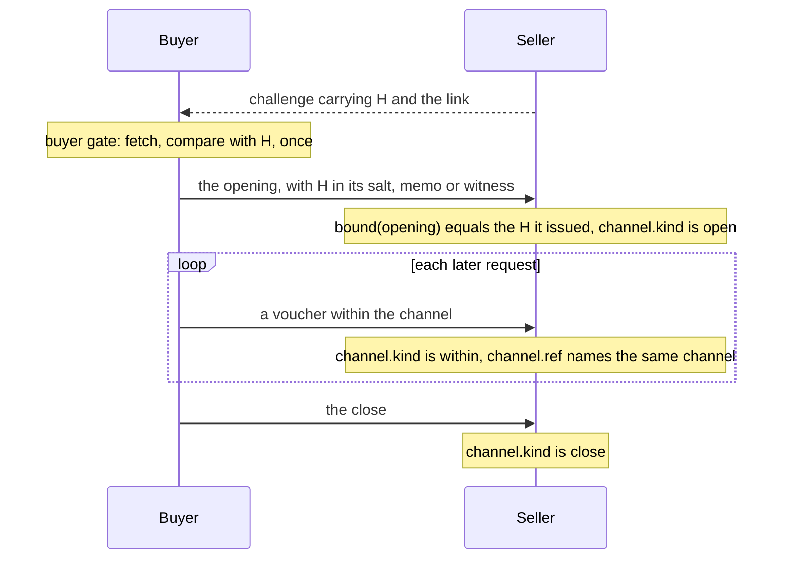

# Channels, sessions and subscriptions

Some payments are not one-off. An x402 `batch-settlement` channel takes a deposit and then pays each request with a
voucher. An MPP `session` does the same with a payment channel, and an MPP `subscription` activates once and renews
each period. Paying request by request under a fresh ATR each time would make every voucher an agreement of its own.

These pairings bind **one ATR to the whole channel, session or subscription**. H rides where the channel opens: in its
salt, its memo, the authorization that activates it, the deposit invoice's description hash on Lightning, or the
request's metadata on Stripe; on the three stock sessions nothing carries it, and the session is served only after an
agreement. The later payments within it carry no ATR of their own. Another agreement opens another channel. This page
gives each channel pairing, the members a channel adds, a program that runs one channel end to end, and how its
settlement is read.



The buyer compares the served bytes with H once, at the opening. After that, a payment within the channel is tied to
the ATR through the channel it belongs to.

## The pairings

Thirteen pairings have a `channel` member. The table says where H rides at the opening, which later payments count as
within the channel, what `channel.boundWithin` and `channel.until` read, and whether the form is confirmed: `yes` where
something outside this package has shown it as its profile defines it. None of these is confirmed yet.

| Pairing | H at the opening | Within, and the close | `boundWithin` | `until` | Confirmed |
|---|---|---|---|---|---|
| `x402/batch-settlement/eip155` | The channel configuration's `salt`. The channel id, which the deposit authorization and every voucher sign, commits to it. In the scheme's refund-authorizer mode (`extra.voucherManager` `"facilitator"` with a non-zero `extra.refundAuthorizer`), the channel salt packs entropy and the refund authorizer, and H is the deposit authorization's salt or the Permit2 deposit's nonce. | A voucher, or a refund whose amount is a positive decimal below 2^128, is within; a full refund, which names no amount, is the close. | The `salt` of the payment's channel configuration, once it hashes to the voucher's channel id. In the refund-authorizer mode it refuses `x402/not-bound-within`, because only the opening carries H. | none | no |
| `x402/batch-settlement/solana` | The opening transaction's seller Memo instruction, H's LCP string (the option's `extra.memo`), beside x402's receiver-authorizer binding memo. | A voucher or a top-up is within; a refund is the close. | Refuses `x402/not-bound-within`. | none | no |
| `mpp/session/evm` | The channel's `salt`: in the signed `open` call, the EIP-3009 nonce MPP derives over the channel parameters and the salt, or the Permit2 witness. | A voucher or a top-up is within; `close` is the close. | Refuses `mpp/not-bound-within`. | none | no |
| `mpp/session/tempo` | The `salt` of the signed `open` call to the channel escrow, in a transaction signed for the challenge's chain. On the v2 escrow the payload's descriptor carries the same salt and parties; on the v1 escrow the payload's `channelId` is the channel that transaction opens. [Checks on the Tempo opening](#checks-on-the-tempo-opening) gives the checks and their order. | A voucher or a top-up is within; `close` is the close. | On the v2 escrow, the salt in the payment's channel descriptor, once the descriptor's channel id is the payment's channel and its operator is the challenge's `methodDetails.operator`, the zero address where the challenge names none, as on the opening. | none | no |
| `mpp/session/xrpl` | The `PaymentChannelCreate`'s one memo holding an LCP string, H's, in an opening the payer signs, single-signed or multisigned, that carries no `NetworkID`, as rippled requires on each network the challenge names, whose ids are at most 1024, else `xrpl/network-mismatch`, which `build`'s `complete` also gives. | A voucher is within; `close` is the close. | Refuses `mpp/not-bound-within`. | The opening's `CancelAfter`, where it sets one. | no |
| `mpp/session/xrpl/stock` | None: the stock client opens the channel itself, out of band, with no memo, so the session is served only after an agreement on its own network is recorded (coverage `none`); an `open` credential is refused `mpp/session-action`, and `bound` refuses a voucher or close `mpp/no-signed-place`. | A voucher, which names the channel, is within; `close` is the close. | Refuses `mpp/not-bound-within`. | none | no |
| `mpp/session/solana/memo` | One Memo instruction, H's LCP string, in the opening the payer signs and the seller's server submits, whose fee payer is the challenge's `operator`. | A voucher or a commit is within; `close` is the close. | Refuses `mpp/not-bound-within`. | none | no |
| `mpp/session/solana/stock` | None: the buyer's client broadcasts the stock opening, which carries no H, so the session is served only after an agreement on its own network (coverage `none`); `bound` refuses `mpp/no-signed-place`. | Only the opening is classified; every later credential is `mpp/session-action`. | Refuses `mpp/not-bound-within`. | none | no |
| `mpp/session/hedera/stock` | None: the stock client opens the channel itself with a random salt, so the session is served only after an agreement on its own network (coverage `none`); `bound` refuses `mpp/no-signed-place`. | A voucher or a `topUp` is within; `close` is the close. | Refuses `mpp/not-bound-within`. | none | no |
| `mpp/session/lightning` | The deposit invoice's description hash `h`, which the seller's node signs. | A bearer proof or a top-up is within; `close` is the close. | Refuses `mpp/not-bound-within`. | none | no |
| `mpp/subscription/tempo` | The `witness` of the key authorization the payer's root key signs. | Only the activation, a key authorization, is classified: it is the opening. | Refuses `mpp/not-bound-within`. | The request's `subscriptionExpires`. | no |
| `mpp/subscription/solana` | The Memo instruction of the activation, H's LCP string (the request's `externalId`). | Only the activation, a `transaction` credential, is classified: it is the opening. Renewals are the seller's pulls. | Refuses `mpp/not-bound-within`. | The request's `subscriptionExpires`. | no |
| `mpp/subscription/stripe` | The request's `methodDetails.metadata.legal_context`. | Every payment the seller reports on this pairing is the activation. | Refuses `mpp/not-bound-within`. | none | no |

This example lists them from the registry:

```ts
import { BINDINGS } from "@integraledger/lcp";

const channels = BINDINGS.filter((b) => "channel" in b).map((b) => b.id);
console.log(channels.length);
console.log(channels.sort().join("\n"));
```

```text
13
mpp/session/evm
mpp/session/hedera/stock
mpp/session/lightning
mpp/session/solana/memo
mpp/session/solana/stock
mpp/session/tempo
mpp/session/xrpl
mpp/session/xrpl/stock
mpp/subscription/solana
mpp/subscription/stripe
mpp/subscription/tempo
x402/batch-settlement/eip155
x402/batch-settlement/solana
```

Three x402 pairings carry a request-scoped form of the same idea, with no `channel` member:
`x402/batch-settlement/cloudflare` echoes H in the `legalContext` extension of each request; `x402/upto/solana`
opens a one-request payment channel whose opening transaction carries H as its memo; and on `x402/upto/xrpl` the payer
opens a payment channel to the option's `payTo` itself, which carries no H, so the payment follows an agreement on the
same network.

The LCP profiles [`x402/batch-settlement/eip155`](../../lcp/profiles/x402-batch-settlement-eip155.md),
[`x402/batch-settlement/solana`](../../lcp/profiles/x402-batch-settlement-solana.md),
[`mpp/session/evm-tempo`](../../lcp/profiles/mpp-session-evm-tempo.md),
[`mpp/session/hedera-solana-xrpl`](../../lcp/profiles/mpp-session-hedera-solana-xrpl.md),
[`mpp/subscription/solana`](../../lcp/profiles/mpp-subscription-solana.md) and
[`mpp/subscription/stripe`](../../lcp/profiles/mpp-subscription-stripe.md) state the rules for these bindings.

### Checks on the Tempo opening

On `mpp/session/tempo`, the opening transaction is signed for the challenge's chain, `methodDetails.chainId` (4217
where a v1 challenge names none), else `tempo/tx-malformed`. On the v2 escrow, the payload's descriptor carries the
`open` call's salt and, as draft-tempo-session-00 requires, its payee, operator, token and authorizedSigner, the open
transaction's sender, recovered from its signature, as its payer, and the expiring nonce hash of that transaction under
that sender, else `tempo/descriptor-mismatch`. On the v1 escrow, the payload's `channelId` is the channel that
transaction opens, computed from its sender and its `open` call, else `mpp/channel-not-bound`.

The transaction is checked first, its `open` call and then its sender, as draft-tempo-session-00's open verification
orders them, and with its sender its `aa_authorization_list`, each entry a list of four items ending in a signature
that is not a keychain signature of type `0x03`, which Tempo's node refuses there as in the sender's. So an opening
with a fault in its transaction and another in its channel id or descriptor is refused with the transaction's code.
`build`'s `complete` returns no credential `bound` refuses: it gives the code `bound` gives the credential it would
give for a transaction, which names the build's `from` (as the v2 descriptor's payer, and in the v1 `channelId`) and
the `open` call `build` made. So it refuses each fault above, a sender other than `from`, a call naming other parties,
and a transaction whose credential is over the credential size bound (`mpp/credential-malformed`); `voucher` refuses
the same transactions.

### How the session pairings read the challenge

An `mpp/session/xrpl` challenge's `amount` is the increment, in drops, charged for its request. `pairingsOf` takes only
an opening challenge, whose `channelId` is absent or empty, and on it `build` signs that `amount` as the first claim's
cumulative total, a big-endian u64. `pairingsOf`, and so `build`, `bound` and `reference`, refuses an `amount` that is
not a u64 written in decimal with no sign, point or leading zero, or a `recipient` that is not a classic address whose
checksum holds (the channel id derives from its AccountID), with `mpp/request-malformed`.

Each session pairing's `bound` and `reference` hold the opening's echoed challenge to its filter, as the
[MPP guide](./mpp.md) says, and its `channel.ref`, given an opening, holds it as `bound` does, so an opening `bound`
refuses for the credential's shape, the challenge's id, intent or method, or the filter is refused by `channel.ref`
with the same code (the Stripe subscription's reads the activation receipt alone), and `channel.until` holds the
opening as `channel.ref` does, giving no end for a payment `channel.kind` refuses or an opening whose echoed challenge
`bound` refuses. Each MPP session pairing's `channel.ref` refuses a payment its `channel.kind` refuses, with that code,
such as one whose action the pairing's draft does not define. Its `closeRef` holds the issued challenge it is given as
`bound` holds an echoed one, so a fault in it gives `bound`'s code: the challenge's shape and its size in the least
credential echoing it (`mpp/credential-malformed`), its `opaque` and `request`, its intent and method, and the filter.
`closeRef` reads no id and no `legalContext`, which carry H: it takes the challenge as issued, before `place`, or as
placed. A within or close payment's challenge, which the seller issues naming the channel, is read without the filter.

## The channel members

On top of the members every pairing has, a channel pairing has:

| Member | Side | What it does |
|---|---|---|
| `channel.kind(payment)` | seller | `"open"`, `"within"` or `"close"`, from the payment's own action or type, or a refusal. |
| `channel.ref(payment)` | seller | The channel's key: `{ network, channel }`. The opening and every payment within share it. On the MPP sessions, a payment `channel.kind` refuses is refused with its code. |
| `channel.boundWithin(payment)` | seller | H from a payment within the channel, where the pairing's payments within carry it; otherwise a refusal. |
| `channel.until(payment)` | seller | The channel's end in Unix seconds, where its opening sets one; on the MPP sessions, none for a payment `channel.kind` refuses or an opening whose echoed challenge `bound` refuses. |
| `buildWithin(within, h)` | buyer | A later voucher, or the close, for a channel opened under H. It refuses a channel that was not, except on `x402/batch-settlement/solana`, whose configuration does not carry H, and in the refund-authorizer mode of `x402/batch-settlement/eip155`, where it holds the channel salt to the option's refund authorizer instead. |
| `closeRef(challenge, channel)` | seller | The read keys of the channel's close, on the MPP sessions on EVM, Tempo and the XRP Ledger, and on `mpp/subscription/tempo`, where a third argument names the payer's account. |

`buildWithin` exists on the two x402 channels and the MPP sessions on EVM, Tempo and the XRP Ledger. On MPP it builds a
voucher or the close. It does not build a top-up, which is a further deposit (`mpp/within-action-not-built`). An action
the pairing's draft does not define, such as a `topUp` on the XRP Ledger, is `mpp/session-action`, as `channel.kind`
answers it.

On MPP, `buildWithin` reads the within challenge, the challenge of the seller's 402 within the channel, as the
pairing's `channel.kind`, `channel.ref` and `channel.boundWithin` read the payment that carries it, with their code for
each fault. It reads a snapshot of the challenge's own members, which the in-channel credential carries. A challenge
that is not an object, is not challenge-shaped or has no string id, or whose least credential is over the credential
size bound, is `mpp/credential-malformed`, and another intent or method `mpp/not-this-pairing`. Then come the request
members the readers read: on the EVM and Tempo sessions its request, `sessionProtocol`, `chainId` and `escrowContract`,
and on the XRP Ledger session its `methodDetails` and the network it names. The seller issues
that challenge with its own id and the channel named, so it is not held to the pairing's filter, which refuses a
challenge naming a channel. Where a reader refuses a payment whose within challenge names channel parameters other
than the opening's, `buildWithin` gives that reader's code. On Tempo, a v2 within challenge whose escrow, chain or
operator does not give the opening's channel, or one over a v1 opening, is `tempo/descriptor-mismatch`, and a v1 within
challenge over a v2 opening is `mpp/not-bound-within`, as `channel.boundWithin` answers. The readers do not compare the
network or escrow a within challenge names with the opening's on the EVM session, a Tempo v1 session or the XRP Ledger
session, and neither does `buildWithin`.

`buildWithin` checks its input in this order: the within challenge and the request members its readers read, H
(`mpp/id-not-ours` for one that is not a valid ATR hash), the cumulative amount, the action, and only then the opening
and its binding to H. The XRP Ledger session decodes its opening with `ripple-binary-codec`, so each check before the
opening gives the same code with the codec and without it.

`mpp/subscription/stripe`'s `channel.ref` takes the payment's receipt as a second argument: the Stripe subscription
it names is the channel.

## One channel, end to end

This program opens an x402 `batch-settlement` channel on an EVM chain, pays one voucher within it, and closes it.
Both sides run in one process: a random key stands in for the buyer's signer and no network is used. Signing uses
[viem](https://viem.sh).

```ts
import { assemble, hashEquals, isRefusal, newAtrId } from "@integraledger/lcp";
import { requestCommitment, tie, type PaymentRequired, type PaymentRequirements } from "@integraledger/lcp/x402";
import { batchEvm, type SigningRequest } from "@integraledger/lcp/x402-batch-settlement";
import type { TypedDataDefinition } from "viem";
import { generatePrivateKey, privateKeyToAccount } from "viem/accounts";

const payer = privateKeyToAccount(generatePrivateKey());
async function sign(requests: readonly SigningRequest[]): Promise<string[]> {
  const out: string[] = [];
  for (const r of requests) {
    if (r.kind !== "eip712") throw new Error(`this signer signs EIP-712 only, not ${r.kind}`);
    out.push(await payer.signTypedData(r.typedData as TypedDataDefinition));
  }
  return out;
}

// Seller: the channel option. 1000 base units of USDC per request, on Base Sepolia.
const option: PaymentRequirements = {
  scheme: "batch-settlement",
  network: "eip155:84532",
  amount: "1000",
  asset: "0x036CbD53842c5426634e7929541eC2318f3dCF7e",
  payTo: "0x209693Bc6afc0C5328bA36FaF03C514EF312287C",
  maxTimeoutSeconds: 60,
  extra: {
    name: "USDC",
    version: "2",
    receiverAuthorizer: "0x209693Bc6afc0C5328bA36FaF03C514EF312287C",
    withdrawDelay: 900,
  },
};
const challenge: PaymentRequired = {
  x402Version: 2,
  resource: { url: "https://api.seller.example/v1/stream" },
  accepts: [option],
};

// Seller: one ATR for the whole channel, and H advertised in the challenge.
const request = await requestCommitment({ method: "GET", target: "/v1/stream", body: new Uint8Array() });
if (isRefusal(request)) throw new Error(request.code);
const terms = new TextEncoder().encode('{"text":"1000 base units of USDC per request."}');
const atr = await assemble(newAtrId(), tie(challenge.accepts, request), [["terms", terms]]);
if (isRefusal(atr)) throw new Error(atr.code);
const link = `https://atr.seller.example/${crypto.randomUUID()}`;
const advertised = batchEvm.advertise(challenge, atr.atrHash, link, option);
if (isRefusal(advertised)) throw new Error(advertised.code);

// Buyer: read H, compare the served bytes with it as the buyer guide shows, then open the channel with H as its salt.
const offer = batchEvm.read(advertised);
if (isRefusal(offer)) throw new Error(offer.code);
const accepted = offer.offer.options[0]!;
const unsignedOpening = await batchEvm.build(
  {
    required: advertised,
    accepted,
    from: payer.address,
    payerAuthorizer: payer.address,
    deposit: 100_000n,
    authSalt: `0x${"01".repeat(32)}`,
    now: Math.floor(Date.now() / 1000),
  },
  offer.h,
);
if (isRefusal(unsignedOpening)) throw new Error(unsignedOpening.code);
const kinds = unsignedOpening.requests.map((r) => (r.kind === "eip712" ? r.typedData.primaryType : r.kind));
console.log("the opening signs:", kinds);
const opening = unsignedOpening.complete(await sign(unsignedOpening.requests));
if (isRefusal(opening)) throw new Error(opening.code);

// Seller: the opening is bound to the H it issued, and names the channel.
const h = await batchEvm.bound(opening);
const channel = await batchEvm.channel.ref(opening);
if (isRefusal(channel)) throw new Error(channel.code);
console.log(batchEvm.channel.kind(opening), "bound to H:", typeof h === "string" && hashEquals(h, atr.atrHash));

// Buyer: a later voucher in the same channel, for a cumulative 2000 base units.
const channelConfig = opening.payload["channelConfig"]!;
const unsignedVoucher = await batchEvm.buildWithin(
  { required: advertised, accepted, channelConfig, maxClaimableAmount: 2000n },
  offer.h,
);
if (isRefusal(unsignedVoucher)) throw new Error(unsignedVoucher.code);
const voucher = unsignedVoucher.complete(await sign(unsignedVoucher.requests));
if (isRefusal(voucher)) throw new Error(voucher.code);

// Seller: the voucher is within the same channel, and its configuration still carries H.
const sameChannel = await batchEvm.channel.ref(voucher);
const within = await batchEvm.channel.boundWithin(voucher);
const same = !isRefusal(sameChannel) && sameChannel.channel === channel.channel;
console.log(batchEvm.channel.kind(voucher), "same channel:", same);
console.log("within bound to H:", typeof within === "string" && hashEquals(within, atr.atrHash));
const notAnOpening = await batchEvm.bound(voucher);
console.log("bound(voucher):", typeof notAnOpening === "string" ? notAnOpening : notAnOpening.code);

// Buyer: the close, a full refund of what is left.
const unsignedClose = await batchEvm.buildWithin(
  { required: advertised, accepted, channelConfig, maxClaimableAmount: 2000n, refund: {} },
  offer.h,
);
if (isRefusal(unsignedClose)) throw new Error(unsignedClose.code);
const close = unsignedClose.complete(await sign(unsignedClose.requests));
if (isRefusal(close)) throw new Error(close.code);
console.log(batchEvm.channel.kind(close));
```

```text
the opening signs: [ 'ReceiveWithAuthorization', 'Voucher' ]
open bound to H: true
within same channel: true
within bound to H: true
bound(voucher): x402/not-an-opening
close
```

Keep the opening exactly as the buyer signed it: every payment within the channel is built from its channel
configuration, and `buildWithin` refuses a configuration whose salt is not H, or, in the refund-authorizer mode, whose
salt does not end in the option's refund authorizer (`x402/channel-id-mismatch`).

## What each side keeps

**The seller** refuses an opening whose H it did not issue for that request, or has already seen used. After that,
it matches each later payment to an open channel by `channel.ref`, and so to that channel's ATR. What a voucher is
worth, and when to settle, are the seller's to decide under the scheme. The channel members classify a payment and
name its channel; none of them reads a voucher's amount.

**The buyer** keeps the ATR's bytes it compared at the opening, and the opening itself. On MPP, a session challenge
that names a `channelId` resumes a channel (`sessionResume` reads it on the MPP sessions on EVM, Tempo, Hedera and the
XRP Ledger; a Solana session challenge names no channel, and `sessionResume` answers `null`): the buyer pays it with a
voucher only for a channel it opened for an ATR it compared.

## What the record says

Each channel pairing's `data.proves` states what the opening shows, and never that later requests or billing periods
were paid under this ATR, which the record never reads. Where each voucher signs a value that commits to H, such as a
`channelId` over the salt, it says so in one sentence, such as *"Each voucher in this channel signs a commitment to
this ATR's hash."* The EVM and Tempo sessions and the EVM batch-settlement channel say so; on the XRP Ledger
session, `data.proves` says that each voucher signs the channel id and an amount, not H. The
[pairings reference](../reference/pairings.md#what-each-binding-proves) quotes each one.

## Reading settlement

`reference(opening, option)` and `status(ref, reader, query)` read the opening's settlement, as on any pairing, and
every answer is one of the closed list [the x402 guide](./x402.md#reading-the-payment) gives. On the MPP sessions on
EVM, Tempo and the XRP Ledger, and on `mpp/subscription/tempo`, `closeRef(challenge, channel)` gives the read keys of
the close from the issued challenge and the channel, and `status` reads the close through the same reader. A failed
result read above the reader's final mark is pending `below-mark`; at that mark, a failed answer comes only once the
search is whole, on a pairing at coverage `full` ([Reading settlement](./rails.md#reading-settlement)).

On the EVM and Tempo sessions and the Tempo subscription, a named transaction that is not the act (an open call for
another channel, a call that is not the close, a transaction sent through an ERC-4337 EntryPoint, a missing log) is no
act, and with no search for H read whole the answer is pending `search-incomplete`. On `mpp/subscription/tempo`, the
close is the account keychain's `KeyRevoked` naming the payer's account and the access key, so
`closeRef(challenge, channel, account)` takes the account the activation registered the key for, which `keySearch`
reads from the activation's receipt as `accessKey.account`; without it, `closeRef` refuses `mpp/input-malformed`.
Another account's revocation of the same key is not this close. On `mpp/session/evm`, `mpp/session/tempo` and
`mpp/subscription/tempo`, a reference that names none of the keys its own pairing writes for the opening or the close
(`opens` or `closes` on the EVM session; `opened` or a binding log under `ChannelClosed` on the Tempo session;
`revokes`, an `accessKey` with `account` or a binding log under `KeyAuthorizationWitness` on the subscription), or
that names a key another of the three writes, is `unreadable`, `unparseable`, and nothing is read: no read could check
H or the close.

The `mpp/subscription/tempo` activation is read by what the payer signed in the key authorization: its `reference`
names the `Transfer` of the authorization's one limit token, which is also its one allowed-call target, to its one
recipient across its `transfer` and `transferWithMemo` rules, identified by the recipient alone, and `accessKey`
carries the same token and recipient for `keySearch`. Tempo's subscription draft lets the key make only those calls and
forbids `approve`, so no other rule names the recipient: an `approve` rule's spender is not one. The request's amount,
currency and recipient are not read. An authorization that names more than one token or recipient, or none, is refused
`tempo/key-authorization-malformed`. A `transfer` or `transferWithMemo` rule with no recipients allows any recipient,
so the authorization does not name exactly one, and it is refused the same way. The key is the one the challenge
issues, on the challenge's chain: Tempo's subscription draft requires the authorization of "the exact access key
described by `methodDetails.accessKey`, including both `accessKeyAddress` and `keyType`", and a chain ID equal to
`methodDetails.chainId`, so a key authorization whose key id, key type or chain id is another is refused
`tempo/key-not-authorized` by `bound`, `reference` and `channel.ref`. The activation, the transfers `keySearch` finds
under the key and the close `closeRef` names are read under that one key.

On `x402/batch-settlement/eip155`, `bound` and `reference` read the opening's deposit amount as the channel contract's
`deposit` takes it, a `uint128` that is not 0: an amount that is not a positive decimal below 2^128 is refused
`x402/payload-malformed`. The reference's `amount` holds that amount. They read the deposit authorization's
`validBefore` or `deadline` as the deposit collectors decode it, a `uint256`: one that is not a decimal below 2^256 is
refused `x402/payload-malformed`, and the reference's `settleBy` is that value in decimal. The channel configuration
that `bound`, `reference`, `channel.ref`, `channel.boundWithin` and `buildWithin` read is held to the rules that
`deposit` applies: a configuration whose payer, receiver, receiver authorizer or token is the zero address, or whose
withdrawal delay is outside 900 to 2,592,000 seconds, is refused `x402/payload-malformed`, and `build` refuses a payer,
or an option's `payTo` or asset, that is the zero address with `x402/option-malformed`. A zero payer authorizer is read:
the payer then signs the vouchers. `channel.kind` reads a refund's `amount`, when it is present, as the channel
contract's `refund` takes it, a `uint128` that is not 0: one that is not a positive decimal below 2^128 is refused
`x402/payload-malformed`. The opening's `status` settles on the deposit into the reference's channel in a transaction
that consumed the deposit authorization's nonce (the token's `AuthorizationUsed(payer, nonce)` on ERC-3009, or the
payer's Permit2 bit for the nonce set at its block and unset at the block before), where the channel's `receiver` is
the option's payee. Any other deposit into the channel is a later payment of it, not the opening. The read defines no
search for H: its search is never whole, and the answer is never `failed` but `before-position`.

On `x402/batch-settlement/solana`, `bound`, `reference`, `channel.ref` and `buildWithin` read the channel
configuration's `withdrawDelay` as the payment-channels program's `grace_period`, a `u32` that its `open` refuses as 0:
a delay that is not a positive integer below 2^32 is refused `x402/payload-malformed`. They read its `payerAuthorizer`
as the program's authorized signer, which `open` refuses off the Ed25519 curve: a key whose bytes are not a point on it,
such as a program-derived address, is refused `x402/payload-malformed`, and `build` refuses one with
`svm/input-malformed`.

An `mpp/session/evm` opening is funded by an `authorization` (EIP-3009) or a `permit2`, which the seller's server
sends; an opening of any other type is `mpp/credential-type`. Its reference carries `opens` (the escrow, the channel, H
and the chain), the payer, the funding, and the payment as presented. `status` reads the opening by its funding, not
by a named transaction: it reads the funding's single-use value at the final and the latest block, and searches the
funding's own logs, the currency's `AuthorizationUsed` of the payer and the nonce, or the payer's `Transfer` to the
escrow. An `authorization`'s nonce is a digest over the recipient and the token as well as H, and a `permit2` signs any
unused nonce, so neither search is a search for H: it is never read whole, and the answer is never `failed` but
`before-position`. A reference whose `opens` is not of that form is `unreadable`, `unparseable`, and nothing is read.

## Next

- [x402](./x402.md) and [MPP](./mpp.md): the surfaces these channels run on.
- [Buyer](./buyer.md): the comparison the buyer makes before the opening.
