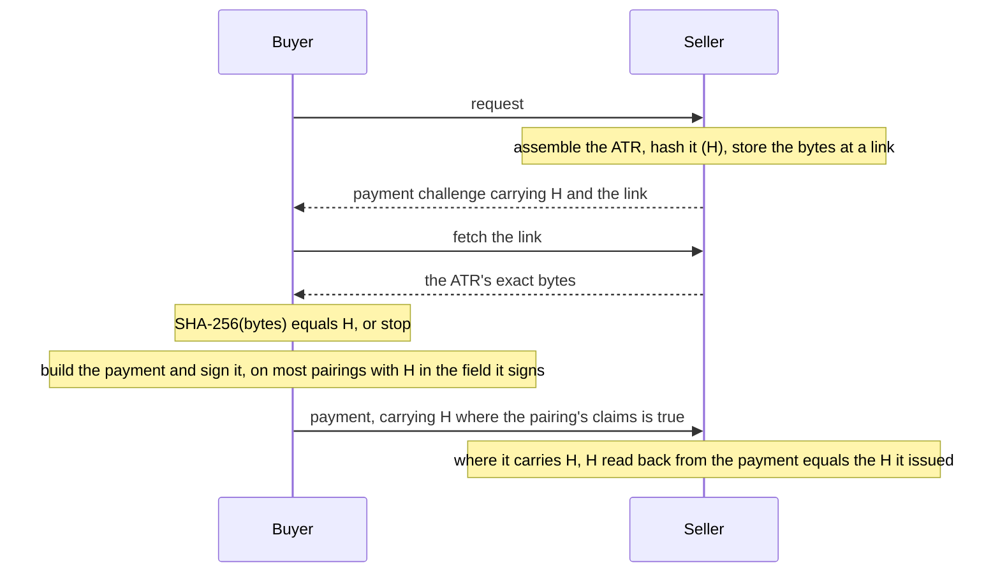

# Overview

When one AI agent buys from another, it reads terms, perhaps negotiates, and pays. The **Legal Context Protocol
(LCP)** binds the payment to the agreement's record: where the payment the buyer approves carries the record's hash, it
shows which exact record the buyer approved, and that approval is the buyer's acceptance of that record; where it does
not, the pairing's statement of what it proves says so.

[`@integraledger/lcp`](https://github.com/IntegraLedger/integra-protocol/tree/main/lcp) is its reference
implementation, for TypeScript and JavaScript. It assembles the record, hashes it, and carries the hash in the
payment, or beside it in an agreement payment, on the x402, MPP, checkout and card pairings it implements: on EVM
chains, Solana, the XRP Ledger and every other rail the [rails guide](./guides/rails.md) lists.

```sh
npm install @integraledger/lcp
```

It needs Node.js `>=24.22.1` (or Cloudflare Workers) and an ESM project. [Getting started](./getting-started.md) runs a
first payment in one program, and [Upgrading](./upgrading.md) says what a release may change and what changed in
0.6.0.

## How it works



1. **The seller assembles the record.** The Agentic Transaction Record holds a format marker, a per-transaction id,
   the values that tie it to this payment, and whatever the parties agreed, byte for byte.
2. **The seller advertises its hash.** H goes into the payment challenge, beside an `https` link to the seller's copy.
3. **The buyer compares before it signs.** It fetches the bytes, hashes them, and signs nothing unless they hash to H.
4. **The payment carries H.** On most pairings the buyer signs a payment with H in the field its protocol or rail
   provides: a nonce, a memo, a salt, an invoice field. Where the pairing's `data.coverage` is `none`, no public act the
   payer signs carries H, whatever the buyer signs, and the agreement payment, made first, is the proof. Each pairing's
   `data.coverage` says which.
5. **Anyone holding the record can match it.** The seller reads H back from the payment where the pairing's `claims` is
   true, and on most rails from the settlement on chain.

The package fixes the bytes, the hash and where H rides. It does not decide what the record says, and it never
compares amount, payee, asset, timing or payer with the record's content: that is between the parties, and the record
is what they agreed.

## Terms

These pages use each term in one sense:

| Term | Meaning |
|---|---|
| **Agentic Transaction Record (ATR)** | The agreement's record: the exact bytes the seller serves; `assemble` writes them as one JSON object. |
| **ATR hash (H)** | SHA-256 over the ATR's exact bytes. |
| **Legal Context Protocol (LCP)** | The pattern this package implements: H bound into the payment, so that where the payment the buyer approves carries H, that approval is the buyer's acceptance of that exact record; where it does not, the pairing's `data.proves` says so. |
| **Pairing** | A payment protocol, scheme and rail combination, such as `x402/exact/eip155/eip3009`. |
| **Binding** | How H rides in a pairing's payment: the field its specification defines. |
| **Binding slot** | The ATR member, written by the pairing's `tie`, that records the payment's values (the options and the request); `assemble`'s `binding` argument. |
| **`Binding`, `BINDINGS`** | In the API, a pairing object is typed `Binding`, and `BINDINGS` holds every pairing. |
| **Buyer gate** | The buyer-side check that compares the served bytes with H before anything is signed. |
| **Seller** | The party serving the resource. |
| **Facilitator** | The x402 role that verifies and settles. |
| **Settler** | This repository's x402 facilitator, `@integraledger/profile-facilitator`. |
| **Vectors** | The shared test cases that fix the rules byte for byte across languages. |

## Where to start

| You are | Read |
|---|---|
| New to LCP | [Getting started](./getting-started.md): one x402 payment, both sides, in one program. |
| Building a seller | [Seller](./guides/seller.md): assemble, advertise, check the payment, read the settlement. |
| Building a buyer | [Buyer](./guides/buyer.md) and [the buyer gate](./concepts/buyer-gate.md). |
| Selling by channel, session or subscription | [Channels, sessions and subscriptions](./guides/sessions.md). |
| Working on one protocol | [x402](./guides/x402.md), [MPP](./guides/mpp.md), or [agentic checkouts](./guides/checkouts.md) for ACP, UCP, AP2, ACK, card networks and A2A. |
| Working on one chain | [Rails](./guides/rails.md): the field H rides in on each chain and on Lightning. |
| Publishing your terms | [Discovery](./guides/discovery.md): the document at `/.well-known/legal-context.json`. |
| Running an x402 facilitator | [The settler](./concepts/settler.md) and [Run the settler](./guides/settler.md): this repository's facilitator for the x402 pairings it settles. |
| Upgrading from an earlier release | [Upgrading](./upgrading.md): what a 0.x release may change, and each change a caller of 0.5.x makes for 0.6.0. |
| Implementing LCP in another language | [Vectors](./concepts/vectors.md) and the [vector files](./reference/vectors.md). |

## The documentation

- **Concepts** explain each rule: [the ATR](./concepts/atr.md), [the ATR hash](./concepts/atr-hash.md),
  [binding](./concepts/binding.md), [pairings](./concepts/pairings.md), [the buyer gate](./concepts/buyer-gate.md),
  [refusals](./concepts/refusals.md), [vectors](./concepts/vectors.md) and [the settler](./concepts/settler.md).
- **Guides** walk each flow with a program you can run: [seller](./guides/seller.md), [buyer](./guides/buyer.md),
  [channels, sessions and subscriptions](./guides/sessions.md), [x402](./guides/x402.md), [MPP](./guides/mpp.md),
  [agentic checkouts](./guides/checkouts.md), [rails](./guides/rails.md), [discovery](./guides/discovery.md) and
  [running the settler](./guides/settler.md).
- **Reference**: [entry points](./reference/entry-points.md), [pairings](./reference/pairings.md),
  [vector files](./reference/vectors.md) and the [API](./reference/api/index.md) are generated from the package;
  [refusal codes](./reference/refusals.md) is written by hand, and CI checks that it lists every code the package
  returns. The [settler reference](./reference/settler.md) is written by hand.

A citation `LCP §N` names section N of the published
[Legal Context Protocol v1.0](https://github.com/legal-context-protocol/legal-context-protocol/blob/main/spec/legal-context-protocol-v1.md).

Every TypeScript program in these pages is compiled and run against the package in CI, and its output is checked
against what the page shows, except the settler's, which need a Postgres database and are marked `no-check`.

## For AI agents

The documentation site publishes [`llms.txt`](https://lcp.integraledger.com/llms.txt), an index of every page that
names the versions the pages document. Each of its sections opens with one file of all its pages, with that file's
size: [concepts](https://lcp.integraledger.com/concepts/llms-full.txt),
[guides](https://lcp.integraledger.com/guides/llms-full.txt),
[reference](https://lcp.integraledger.com/reference/llms-full.txt) and
[API](https://lcp.integraledger.com/reference/api/llms-full.txt).
[`llms-full.txt`](https://lcp.integraledger.com/llms-full.txt) holds every page in one file, larger than most context
windows. Each page is Markdown at its address with `.md` added, such as
[`/getting-started.md`](https://lcp.integraledger.com/getting-started.md), or at its own address for a request whose
`Accept` header ranks `text/markdown` at least as high as `text/html`.

The site also serves the protocol's documents as this package ships them. Each profile is at `/profiles/<name>.md`,
listed in [`/profiles/llms.txt`](https://lcp.integraledger.com/profiles/llms.txt) and gathered in
[`/profiles/llms-full.txt`](https://lcp.integraledger.com/profiles/llms-full.txt); each vector file is at
`/vectors/<name>.json`, listed in [`/vectors/llms.txt`](https://lcp.integraledger.com/vectors/llms.txt).

## Source and license

The source is at [github.com/IntegraLedger/integra-protocol](https://github.com/IntegraLedger/integra-protocol),
under the [Apache-2.0](https://github.com/IntegraLedger/integra-protocol/blob/main/LICENSE) license. The buyer
packages are documented at [agenticterms.integraledger.com](https://agenticterms.integraledger.com).
